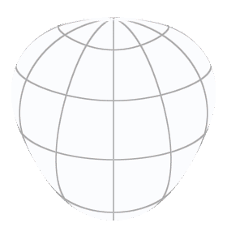
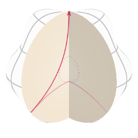
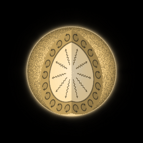
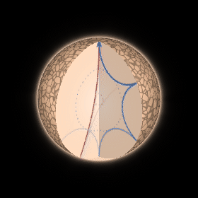

# 🌟 astro-presentations

**Animated stars for talks: pulsating stars, sound waves inside them, stars cut open, light curves
you can hear, all in [reveal.js](https://revealjs.com) slides.**

<p align="center">
  
  
  
  
</p>

Made for *The stars sing*, a 15-minute public talk on asteroseismology (`index.html`). Every object
is a plain HTML tag with a few attributes, and every animation steps with your clicker:
**next** makes it happen, **back** undoes it.

👉 **[See all the animations](gallery/README.md)**, or make your own GIFs with one command
([below](#-make-gifs-for-anything-else)).

---

## 🚀 Quick start

```bash
git clone https://github.com/Johanneshj/astro-presentations.git
cd astro-presentations
python3 tools/serve.py
```

Your browser opens the talk. Use `starter.html` to start a new talk with all plugins loaded.

| Key | |
|---|---|
| **→ / Space** | next step |
| **S** | speaker view, with notes and the next slide |
| **F** | full screen |
| **D** / **Shift+D** | projector colours on / off, and fine-tune them |
| **O** | overview of all slides |

## 🧩 Plugins

Put the tag on a slide and the plugin does the rest. Each one has its own page with every option.

| | Tag | What it is |
|---|---|---|
| 🌐 | [`<div class="star">`](docs/pulsating-star.md) | A star pulsating in one spherical harmonic (ℓ, m). It can be cut open to show the sound rays inside. |
| ⭐ | [`<div class="stellar">`](docs/stellar.md) | A rotating, glowing star with granulation, spots or a disk. Cut it open to show its zones, its core or its sound rays. |
| 🍰 | [`<div class="stellar-quarter">`](docs/stellar.md) | A star with a quarter cut out, one piece of physics per quarter. |
| 📈 | [`<div class="graph">`](docs/graph.md) | Light curves and spectra, traced live, with sound, zooms, arrows and labels. |
| 🎸 | [`<div class="guitar">`](docs/guitar.md) | A guitar body showing its vibration modes. |
| 〰️ | [`<div class="string">`](docs/string.md) | A standing wave on a string: pick the mode and the speed. |
| 🕰️ | [`<div class="pendulum">`](docs/pendulum.md) | A pendulum you raise, release and measure. |
| 📉 | [`<div class="pendulum-graph">`](docs/pendulum-graph.md) | The pendulum's swing, traced as a graph. |
| 🔊 | [`data-sound`](docs/sound.md) | Play a sound on a click. |
| 📝 | [`<div class="text">`](docs/text.md) | Text placed anywhere on a slide. |
| 🎤 | [`<div class="microphone">`](docs/props.md) | Simple drawings: a microphone and a clapperboard. |
| ↗️ | [`data-move-step`](docs/move.md) | Glide any object to a new place on a click. |
| 📽️ | [`D` key](docs/projector.md) | Projector colours: keeps bright details visible on a weak projector. |
| 🌌 | [theme](docs/theme.md) | The 3D starfield behind the slides, colours and layouts. |

For example, a dipole mode that starts pulsating on the next click:

```html
<div class="star" data-l="1" data-m="0" data-radius="150" data-pulse-step></div>
```

Want your own plugin? See [docs/writing-plugins.md](docs/writing-plugins.md).

## 🎞️ Make GIFs for anything else

`tools/make_animation.py` turns the same objects into **seamless loops** to use anywhere: other
slides, papers, websites. Set it up once:

```bash
python3 -m venv .venv
.venv/bin/pip install playwright pillow numpy
.venv/bin/python -m playwright install chromium
```

Then run it and answer a few questions (which object, ℓ, m, size, background, ...):

```bash
.venv/bin/python tools/make_animation.py
```

or say it all at once:

```bash
.venv/bin/python tools/make_animation.py --kind harmonic --l 4 --m 2 --size 800 --out my_mode.gif
```

- **Objects:** `harmonic`, `harmonic-rays`, `rays`, `star`, `star-open`, `star-rays`
- **Size:** `--size` in pixels, any resolution
- **Background:** `transparent`, `black`, `white` or any colour
- **Format:** `.gif`, `.webp`, `.png` (animated) or `.mp4`, from the file name

All options: [docs/make-animation.md](docs/make-animation.md).

## 📁 What's where

```
index.html        the talk "The stars sing"      starter.html   an empty deck
plugins/          the animated objects            docs/          one page per plugin
theme/            starfield and styles            gallery/       the GIFs
data/             Kepler light curves, spectra    media/         sounds
tools/            serve.py, make_animation.py     vendor/        reveal.js
```

**Your own data:** any text table of time and brightness works:
`<div class="graph" data-src="data/my-star.txt">`. See [docs/graph.md](docs/graph.md).

**No internet at the venue?** three.js comes from a CDN. Run `npm install && npm run vendor`
and point the import map in `index.html` at `./vendor/three/three.module.js`.

## 📜 Licence and credits

MIT, see [LICENSE](LICENSE). Built on [reveal.js](https://revealjs.com) and
[three.js](https://threejs.org) (both MIT). Fonts are under the SIL Open Font License
(`theme/fonts`). The light curves are from NASA's Kepler mission, via the
[MAST archive](https://archive.stsci.edu/).
