# Gallery

Every animation here is made by [`tools/make_animation.py`](../tools/make_animation.py) and loops seamlessly. Make one again, at any size or as WebP / MP4:

```bash
.venv/bin/python tools/make_animation.py --gallery --only star_sun_open
```

or answer a few questions to make your own: `.venv/bin/python tools/make_animation.py`.

## 🌐 Spherical harmonics

A star ringing in one mode (ℓ, m). Red: the surface moving in, blue: moving out (like a Doppler shift). Transparent background.

| ℓ = 1, m = 1 | ℓ = 2, m = 0 | ℓ = 3, m = 2 | ℓ = 5, m = 3 | ℓ = 12, m = 6 |
|:---:|:---:|:---:|:---:|:---:|
| 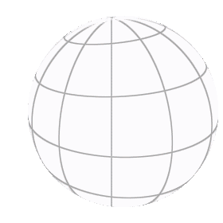 | 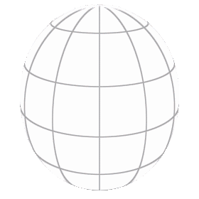 | 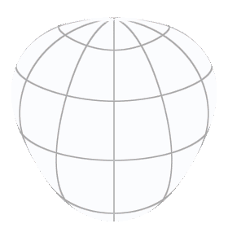 | 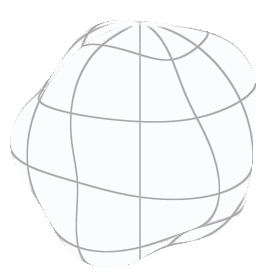 | 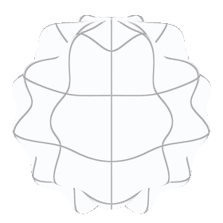 |
| <sub>`harmonic_l1_m1`</sub> | <sub>`harmonic_l2_m0`</sub> | <sub>`harmonic_l3_m2`</sub> | <sub>`harmonic_l5_m3`</sub> | <sub>`harmonic_l12_m6`</sub> |

## 〰️ Acoustic rays

Sound waves travelling inside a star, drawn in a cross-section. Low degree ℓ dives deep, high ℓ stays near the surface; the dotted circle is where each ray turns back.

| ℓ = 1 | ℓ = 2 | ℓ = 20 | three ℓ = 1 | ℓ = 1, 5, 20 |
|:---:|:---:|:---:|:---:|:---:|
| 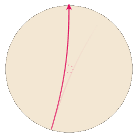 | 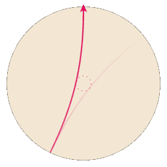 | 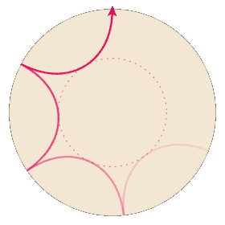 | 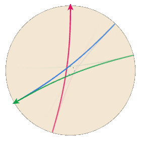 | 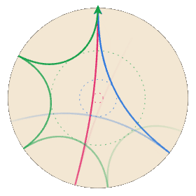 |
| <sub>`rays_l1`</sub> | <sub>`rays_l2`</sub> | <sub>`rays_l20`</sub> | <sub>`rays_dipoles`</sub> | <sub>`rays_l1_5_20`</sub> |

## 🌐〰️ Harmonics with their rays

The pulsating star cut open, with the rays of its mode inside.

| ℓ = 1, m = 0 | ℓ = 2, m = 1 | ℓ = 3, m = 3 | ℓ = 6, m = 2 | ℓ = 20, m = 10 |
|:---:|:---:|:---:|:---:|:---:|
| 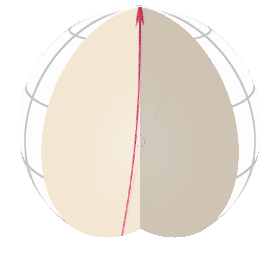 | 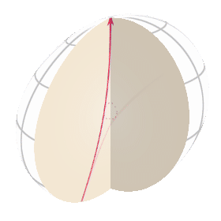 | 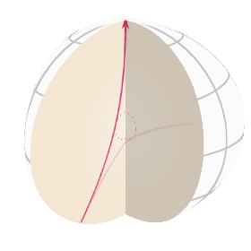 | 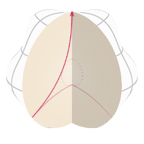 | 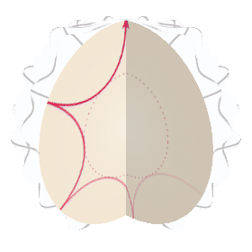 |
| <sub>`harmonic_rays_l1_m0`</sub> | <sub>`harmonic_rays_l2_m1`</sub> | <sub>`harmonic_rays_l3_m3`</sub> | <sub>`harmonic_rays_l6_m2`</sub> | <sub>`harmonic_rays_l20_m10`</sub> |

## ⭐ Stars

Closed, and cut open: radiative zones (wiggly arrows: energy carried by light) and convective zones (loops: energy carried by boiling gas).

| Star | Closed | Open | With rays |
|---|:---:|:---:|:---:|
| **The Sun**<br><sub>`--star sun`</sub> | 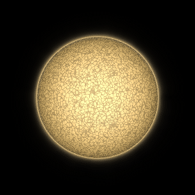 | 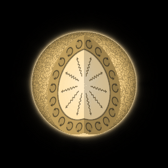 | 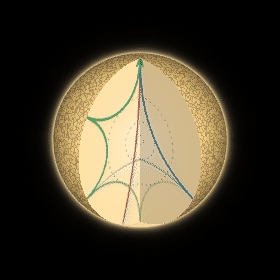 |
| **Red giant**<br><sub>`--star red-giant`</sub> | 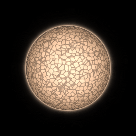 | 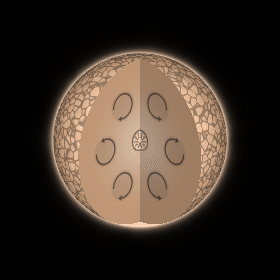 | 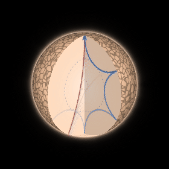 |
| **Massive blue star**<br><sub>`--star blue`</sub> | 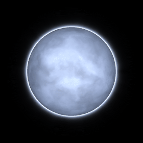 | 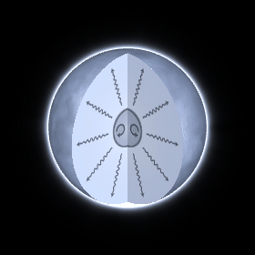 | 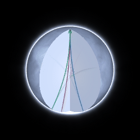 |
| **Red dwarf**<br><sub>`--star red-dwarf`</sub> | 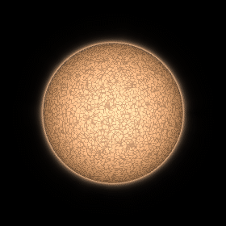 | 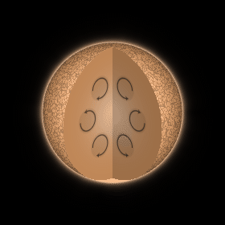 | 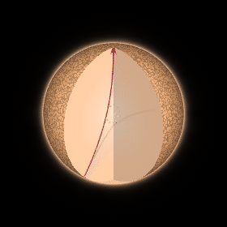 |
| **Young star with its disk**<br><sub>`--star young`</sub> | 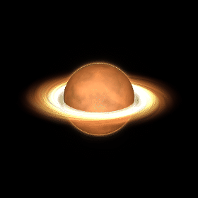 | 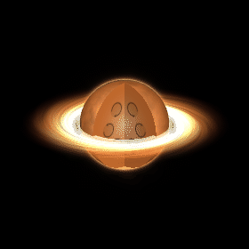 | 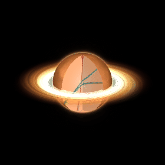 |
